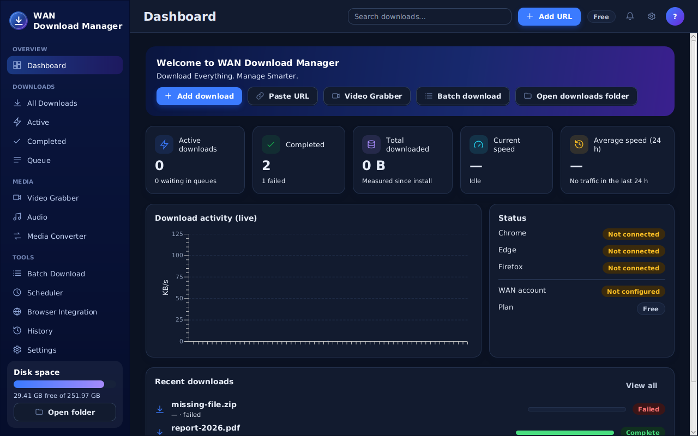

# WAN Download Manager

**Download Everything. Manage Smarter.** — a local-first Windows download manager in the WAN ecosystem:
accelerated, resumable downloads, browser video detection, media conversion, queues and scheduling,
with sign-in by **WAN Identity Hub** and design based on **WANBAHJAHKAS LTD**.



| Part | Path | Stack |
|---|---|---|
| Embedded backend | `backend/` | Java 21, Spring Boot 3.5, SQLite + Flyway, Nimbus JOSE |
| Desktop app | `desktop/` | JavaFX 21 (WAN design system in `src/main/resources/design`) |
| Native messaging host | `native-messaging/host` | Java 21 |
| Browser extensions | `browser-extensions/` | TypeScript, Manifest V3 (Chrome, Edge, Firefox) |
| Installer | `installer/windows`, `scripts/package.ps1` | jpackage + WiX |

## Quick start
```bash
mvn -B install                                  # builds and tests everything Java
npm --prefix browser-extensions ci && npm --prefix browser-extensions test
java -jar desktop/target/wdm-desktop.jar
```
Windows: `scripts\build.ps1`, `scripts\test.ps1`, `scripts\package.ps1`, `scripts\install-dev.ps1`.

## Status
Development build — see [`docs/PROJECT-STATUS.md`](docs/PROJECT-STATUS.md) and
[`docs/KNOWN-ISSUES.md`](docs/KNOWN-ISSUES.md). WAN sign-in requires the proposed WAN Identity Hub patch
([`docs/WAN-IDENTITY-INTEGRATION.md`](docs/WAN-IDENTITY-INTEGRATION.md)).

## Documentation
[Architecture](docs/ARCHITECTURE.md) · [Identity audit](docs/WAN-IDENTITY-AUDIT.md) · [Identity integration](docs/WAN-IDENTITY-INTEGRATION.md) ·
[Design system audit](docs/WAN-DESIGN-SYSTEM-AUDIT.md) · [WANBAHJAHKAS integration](docs/WANBAHJAHKAS-INTEGRATION.md) ·
[Database](docs/DATABASE.md) · [API](docs/API.md) · [Security](docs/SECURITY.md) · [Browser integration](docs/BROWSER-INTEGRATION.md) ·
[Installation](docs/INSTALLATION.md) · [Development](docs/DEVELOPMENT.md) · [Troubleshooting](docs/TROUBLESHOOTING.md) ·
[Release](docs/RELEASE.md) · [Tracker](docs/IMPLEMENTATION-TRACKER.md)

## Principles
Never fake progress, sizes or video qualities · never bypass DRM or site access controls · never store
passwords or log tokens · every network request passes the SSRF policy · premium features are decided
only by verified WAN entitlements.
